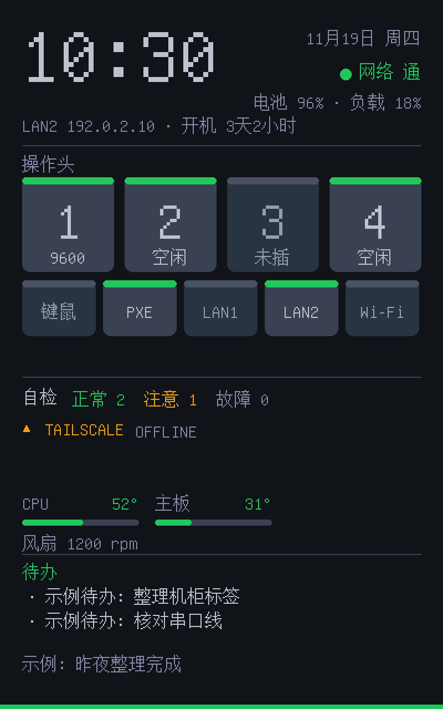
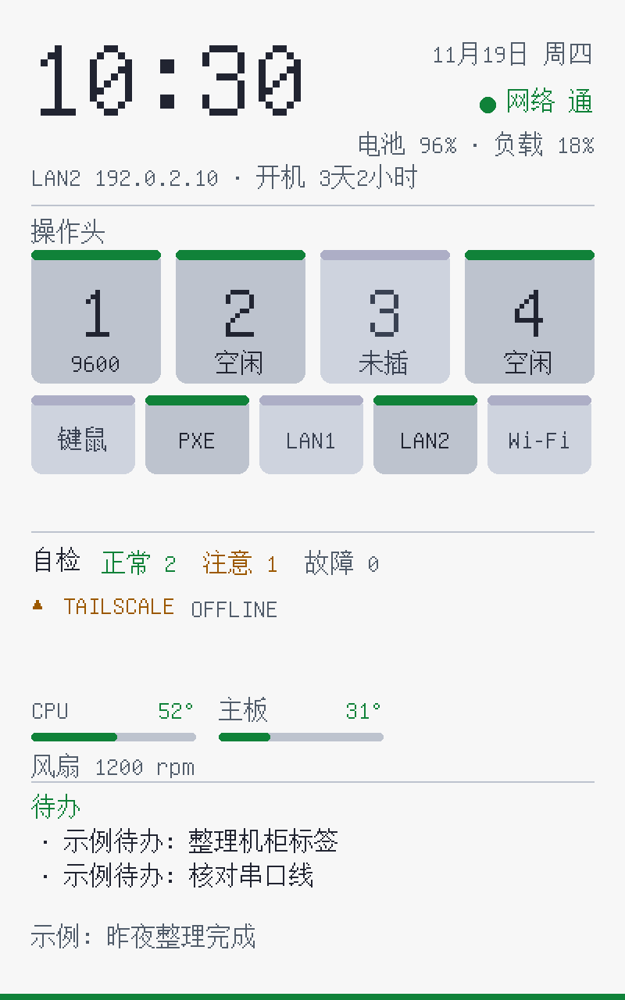

# cart-dash 接 Monita-CS80：一页总结

分支 `feat/monita-dash`，未合并、未上车、未 push。设计稿和完整 TODO 见 [monita-dash.md](monita-dash.md)。

## 做了什么

- `dash_service.py --display cs80` 把状态板推到 Monita-CS80，默认仍是 udisp，`cart-dash.service` 不用改就是老行为。
- **版面没重排**：查下来 CS80 就是竖屏 800×1280（RGB565 小端），和 `dash_render` 的坐标系一样。CS80 出口不转向、不编 JPEG，直接转 RGB565 推。HELLO_ACK 里尺寸 / 格式 / 协议版本不符就拒绝连接，不硬缩放。
- **协议**：`cs80_proto.py`（纯函数编码 / 解析）+ `cs80_link.py`（串口 raw、整帧写完、按 type+seq 等 ACK、KEY 分流）。按协议文档从零写，没复制 Monita 仓库的代码。只做 HELLO、SEG、RECT、PRESENT、BACKLIGHT、LED、PING，再加收 KEY。
- **推帧**：每 16 行一条带做差分，横向对齐 32 像素，按 `max_payload` 切块，一批 RECT 后发 PRESENT 等 ACK。PRESENT 的 ACK 回来才算提交。设备报了错数、刚 HELLO 或超时重连时推整帧。
- **段码屏**：主区放本机时钟 `HH:MM:SS`，小时钟区放 UPS 电量（走电池时改显示剩余分钟），`元88` 放自检 FAIL+WARN 数，再加电池格 / 闪电和 WiFi 格。
- **灯**：自检中蓝常亮，告警红闪，注意黄，正常绿。告警包括自检 FAIL、UPS 或 PXE 服务 bad、Agent 急停；注意包括 WARN 和有待确认。
- **按键**：只有 + 开背光、− 关背光。≡ 和查询键不用，不做任何确认类操作。
- **热插拔 / 保活**：每 0.2 s 一轮采集都调一次 `tick()`，SEG 每秒一次，顺带喂固件 5 s 的“主机走了”看门狗。拔屏、写失败或 ACK 超时就关掉，3 s 后重新找节点；HELLO 超时则 3 → 30 s 退避。日志只在状态变化时打。不发 SLEEP。
- **顺手修了 main 上的一处**：没猫时拔屏，以前要等到下一分钟才重连，现在 3 s。
- 设备发现只认 sysfs 里 `2c7c:0901` 接口 07 的节点，不会往 `/dev/con-*` 这类 console 口写东西。

## 怎么验证的

- 3.13 全仓 7500+ 条绿；系统 Python 3.9.6 + Pillow 11.3 全仓绿。
- 新增约 120 条单测（含参数化）：字节级编码样例、PTY 上的 raw / 大帧写、假设备会话、假时钟下的保活节奏 / 灯 / 段码屏 / 按键 / 重连 / 退避。
- fwsim 联调 11 条（可选，`CS80_FWSIM` 指向本机编译的固件模拟器才跑），3.13 和 3.9 都过。覆盖整帧和差分推完后屏上 CRC 一致、段码屏显存一致、灯、按键、停发 5.6 s 回开机页后自愈、关 PTY 重连、16 KiB `max_payload`、单缓冲、无灯无键固件，以及 `dash_service` 端到端。
- **没上真机**。Mac 上这个接口没有串口节点，真机要在 Linux 上测。

预览（推到 CS80 上的画面，已经过 RGB565 量化，数据是虚构的）：

| 深色 | 浅色 |
|---|---|
|  |  |

## 上车步骤草案（纸面，未执行）

0. 先在一台 Linux（不是推车）接真机过一遍：`ls /sys/class/tty/`，插上后应多出 `ttyUSB*` 或 `ttyACM*`；然后 `python3 dash_service.py --display cs80` 看画面、段码屏、灯、+ / − 键。
1. 随下一个版本打包。新模块会被 `pack-*.sh` 自动带上，`accept_core` 清单已加；但新版本号的 install / pack / 部署文档还没写。
2. 推车上确认 venv 里的 Pillow ≥ 8.2：`/opt/pxe/venv/bin/python -c "import PIL; print(PIL.__version__)"`。这是 main 上 `dash_render` 原有的要求。
3. 插屏，看 `ls /sys/class/tty/ | grep -E 'ttyUSB|ttyACM'`。没有节点就停在这里，说明 `option` 驱动不认这个口，回来定是 `new_id` 还是改用 pyusb。
4. 屏蔽 ModemManager（若在跑）。在 `/etc/udev/rules.d/` 下加一条：`ATTRS{idVendor}=="2c7c", ATTRS{idProduct}=="0901", ENV{ID_MM_DEVICE_IGNORE}="1"`，然后 `udevadm control --reload` 并重新插拔。
5. 切换：`systemctl edit cart-dash`，写入
   ```ini
   [Service]
   ExecStart=
   ExecStart=/opt/pxe/venv/bin/python /opt/pxe/dash_service.py --display cs80
   ```
   然后 `systemctl restart cart-dash`，用 `journalctl -u cart-dash -f` 应能看到 `副屏已连接 'Monita-CS80 fw v10 ...'`。
6. 量一下：`dc.collect` 最长耗时，以及猫动的时候 CPU 占用（设计稿 TODO 第 6 条）。
7. 回滚：`systemctl revert cart-dash && systemctl restart cart-dash`，就回到 udisp。

## 待你决定

1. **许可证**：现在 ops-cart（MIT）里是独立实现的编码器，不依赖 Monita（PolyForm Noncommercial）的代码。要不要把 Monita 的协议文档 / 参考实现改成 MIT，或者单独抽一个 MIT 协议包？
2. **默认屏**：现在默认 udisp，CS80 要显式 `--display cs80`。上车后要不要改默认？
3. **上车时机**：建议顺序是 fwsim（已过）→ Linux 接真机 → 推车。固件 v8–v10 的 KEY / LED / 主机走了在协议文档里还标着“未上真机测”。
4. 其他见设计稿第 12 节：屏竖装还是横装、udev 规则放哪、正常时绿灯要不要灭、空闲关屏。

## CART-LOG 摘要草稿（上车那天用）

```text
YYYY-MM-DD  cart-dash 副屏换 Monita-CS80 (版本 x.y.z, 分支 feat/monita-dash)
  - 改动: systemd drop-in cart-dash.service.d/override.conf, ExecStart 加 --display cs80; udev 加 ModemManager 忽略规则
  - 验证: journal "副屏已连接 Monita-CS80 fw v10"; 段码屏走时钟、灯绿、+/- 开关背光; 拔插 3 s 内恢复
  - 回滚: systemctl revert cart-dash && systemctl restart cart-dash (回 udisp); 删 udev 规则
```
