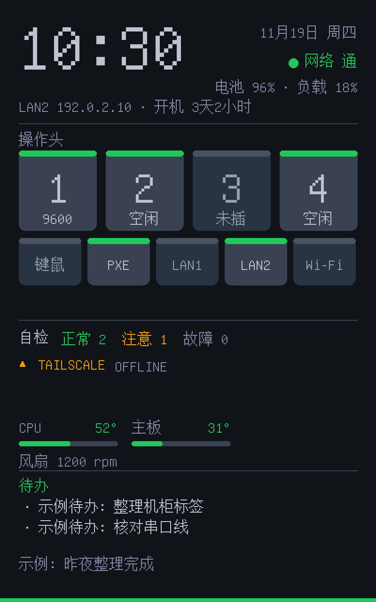
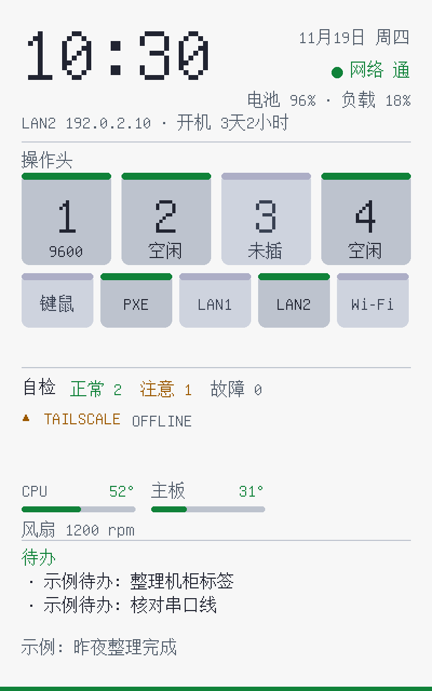

# cart-dash 接 Monita-CS80 副屏：设计稿

状态：v1 已实现（2026-11-19），只对固件模拟器联调过，未上真机、未上车。分支 `feat/monita-dash`。实现记录见文末。

目标：cart-dash 除了现有的 xfz1986 ESP32-P4 USB 副屏（下称 udisp），也能把状态板推到 Monita-CS80（收款机改造的 800×1280 屏 + 段码屏 + RGB 灯 + 4 个按键，下称 CS80）。只读展示，不加任何会改推车状态的操作。

协议依据：Monita 仓库 `docs/protocol.md`、`docs/segmap.md`（固件 v10，分支 `fw-v10-hostlost`）。下文说的“协议文档”都指它们。

## 1. 先说结论：版面不用重排

任务最初的设想是“CS80 分辨率和 udisp 不同，版面要重排”。查下来不成立：

| | udisp | CS80 |
|---|---|---|
| 设备报的尺寸 | 配置串 `R1280x800`（横屏帧头坐标） | HELLO_ACK `width=800 height=1280` |
| 面板物理朝向 | 竖屏，`dash_render` 按 800×1280 画完再 `rot90` | 竖屏原生，行跨度 1600 B，一帧 2,048,000 B |
| 像素格式 | JPEG（≤100 KB） | RGB565 小端（R 在高 5 位，`0xF800` 是红） |
| 局部刷新 | 不显示（2026-11-02 实测） | RECT 任意矩形，无对齐要求 |

`dash_render.render(view)` 出的竖屏 800×1280 图本来就是 CS80 要的坐标系，所以：

- **版面、字号、分隔线、桌宠坐标（`pet_core` 里写死的 W/CEILING/DIVIDER_Y/FLOOR_Y）一律不改**；
- CS80 出口**不转向、不编 JPEG**，直接把 RGB 图转成 RGB565，按脏区发 RECT；
- 深浅主题照旧（`th.use()` 在排版之前切配色，CS80 只是另一个出口，不感知主题）。

保险：后端在 HELLO_ACK 里校验 `proto_ver == 0`、`width == 800`、`height == 1280`、`pixfmt == 1`，不符就当“打不开”（日志带上是哪一项不符，3 s 后重试），不去硬缩放。

屏在车上怎么装（竖装还是横装）还没定，见第 12 节。若横装，再在出口加一次转向即可，版面仍不动。

## 2. 后端抽象：并存的最小改法

现状（`dash_service._loop`）：`factory().open_display()` 返回带 `send(bytes)`、`close()`、可选 `cfg_text` 的对象；`paint(view)` 返回**已转向的 JPEG**（`make_frame` 和 `pet_render.Stage.frame` 都把转向和编码焊在里面）。

改法：显示对象**自愿声明**要图而不是要字节，旧路径一个字节都不变。

```text
udisp_usb.Display          send(jpeg_bytes) / close() / cfg_text          # 不动
monita_cs80.Display        wants_image = True
                           send(img)        # img: 竖屏 800×1280 PIL RGB 图
                           tick(now, snap, view) -> None   # 每轮采集都调；按键在后端内部消化
                           close()
                           cfg_text
```

`dash_service` 的改动：

1. `paint(v)` 拆成两步：先出图，再按后端要什么交出去。
   - 有 `wants_image`：没猫用 `dash_render.render(v)`；有猫用 `Stage.image(v, pet)`（新方法，返回贴好猫的 RGB 图）。
   - 没有 `wants_image`：照旧 `make_frame(v)` / `Stage.frame(v, pet)`。`Stage.frame` 改成 `encode_within_budget(rot90(self.image(...)))`，输出逐字节不变。
   - 注入了 `render=`（测试）时照旧直接用它。`test_make_frame_is_landscape_for_the_panel` 和降质那条测试保持原样通过。
2. **每轮采集**（0.2 s）只要 `disp` 开着且有 `tick` 就调一次 `disp.tick(now, snap, view)`，**不受 `want` / `max_gap` 控制**。保活、段码屏、灯、读按键都在 `tick` 里做。`tick` 抛异常和 `send` 抛异常走同一条“关掉、3 s 后重连”的路。
3. 重连要按时间驱动（见第 8 节的问题 1）。

不起线程：CS80 后端所有动作都在采集线程里、带超时（写 ≤ 1 s，等 ACK ≤ 0.5 s，等 HELLO_ACK ≤ 1 s），保活靠 `tick` 每 0.2 s 一次的机会。后端自愈：距上次发送 ≥ 3.5 s 就先 HELLO、重发灯和背光、推整帧；ACK 报了错数增加时，下一轮 `tick` 就补推整帧（补了还错的话最多 1 s 一次），不等下一次 `send`。

HELLO 超时（节点在但不应答：旧固件、口被别的程序占着）每次会卡采集线程 1 s。HELLO 超时不缩短（协议文档说刚枚举那一下会丢数据），改为重连间隔翻倍退避（3 → 6 → 12 → 24 → 30 s 封顶）；找不到节点等别的失败照旧每 3 s 试一次，udisp 不受影响。

## 3. 协议编码器：ops-cart 内独立实现

新模块（MIT，按协议文档从零写，**不复制 Monita 仓库任何代码**，包括 `tools/host-ref` 和 `tools/fwsim`）：

- `cs80_proto.py`：纯函数，无 I/O。帧编码、流式解析、HELLO_ACK / ACK / KEY 解码、段码屏编码、RGB565 转换、脏区计算。
- `cs80_link.py`：字节流传输 + 会话（HELLO、按 type+seq 等应答、KEY 分流、超时）。
- `monita_cs80.py`：`open_display()` 和 `Display`，接到 dash_service。

帧格式（全小端）：`A5 5A | u8 type | u8 seq | u16 len | payload | u32 crc`，CRC 用 `zlib.crc32` 算 `type..payload`（不含 `A5 5A`）。坏帧设备静默丢弃、不应答。

只实现用到的消息：

| type | 名字 | 方向 | 用途 | 应答 |
|---|---|---|---|---|
| 0x01 | HELLO | → | 握手；带 `u32 unix_time + i16 tz_min` | HELLO_ACK 0x81（16 B） |
| 0x10 | SEG | → | 72 字节段码屏显存 | ACK |
| 0x20 | RECT | → | `u16 x,y,w,h` + RGB565 | **无** |
| 0x21 | PRESENT | → | `u16 frame_id`，一批 RECT 的同步点 | ACK（40 B） |
| 0x30 | BACKLIGHT | → | 背光开 / 关 | ACK |
| 0x31 | LED | → | 灯三态 | ACK |
| 0x32 | SLEEP | → | v1 不发（第 7 节） | ACK |
| 0x7F | PING | → | 保活 | ACK |
| 0x90 | KEY | ← | 设备主动上报，`seq=0` | 主机不应答 |
| 0xFE | ACK | ← | `for_type, status`，再 9 个 u32 计数 | — |

不实现：COPY（只对滚动有用）、FBCRC、DIAG、沉浸模式 IMM_*。

要点：

- 等应答时按 type 分流：KEY 进按键队列，其余按 type+seq 匹配；对不上的丢掉。拆设备回包时坏帧前进 1 字节重新找 `A5 5A`。每次打开节点后先 `tcflush(TCIOFLUSH)`，丢掉上一次会话残留的字节和迟到的 ACK。
- RECT 载荷必须正好 `8 + w*h*2` 且 ≤ HELLO_ACK 的 `max_payload`（不写死 32768；测试里用 16384 验证）。`max_payload < 8 + 32*16*2 = 1032`（一个 tile 都放不下）当不兼容处理，不为它做行数退化（fwsim 允许 16 起，只在这里拒）。
- 一个协议帧必须一次写完：设备侧半截帧 0.5 s 没后续就丢。
- HELLO_ACK 还要校验 `seg_bytes == 72`；不是 72 就不发 SEG，保活全靠 PING。
- `caps` 按位开功能：bit4 KEYS、bit5 LED、bit7 SLEEP / 主机走了。没有的位就不发对应消息（fw v8 之前的固件只当屏用）。PRESENT 在 v0 起就有，单 / 双 / 三缓冲都照样发、照样等 ACK，主机侧不按 bit1 / bit3 分支。
- 非 RECT 消息的 ACK `status != 0`（1 参数错、3 不支持）：不当断线，打一次日志、这一项功能本次会话停用（比如 LED 回 3 就不再发 LED）。
- PRESENT 的 ACK 里 `crc_err + len_err + bad_param` 比上一次大，说明之前的 RECT 有被拒的，下一帧推整帧。HELLO 会把计数清零，所以基线在每次 HELLO_ACK 之后重置为 0。

## 4. 推送策略：脏区 + PRESENT

后端缓存上一次**已提交**的 RGB 图（800×1280）。每次 `send(img)`：

1. 和上一帧做差（`ImageChops.difference`），按 16 行一条带取 `getbbox()`；有变化的条带，把横向范围对齐到 32 像素，成为一个 RECT（等价于 32×16 tile 差分后同一行合并，只是不拆开中间的干净 tile，简单）。
2. 单个 RECT 超过 `max_payload` 就横向切开（每块宽 ≤ `(max_payload - 8) // (16*2)`，向下对齐到 32）。800 宽、16 行是 25,608 B，在 32768 下一条带一个 RECT；整帧 80 个 RECT。
3. 转 RGB565 用 Pillow 的通道查表：`split()` → `point()` 做高 / 低字节 → `ImageChops.add` → `Image.merge("LA", (lo, hi)).tobytes()`，不用逐像素 Python 循环，也不依赖各版本不一致的 16 位 raw 模式。
4. 发完这批 RECT，发 PRESENT，等 ACK 才返回（这是唯一的等待，也是流控）。
5. 下列情况推整帧：刚 HELLO、上次 ACK 报错数增加、上次 `send` 失败。
6. 只有 PRESENT 的 ACK 回来后才把这张图记成“已提交”；ACK 超时则不更新缓存，并按断线处理（关掉、3 s 后重连、HELLO、整帧）。协议文档对坏帧的建议就是“等应答超时后重发整帧”，重连路径正好覆盖，不另写重发逻辑。
7. 后端只读 `send(img)` 收到的图，不在上面画东西。没猫时 `Stage.image` 会把缓存底图原样交出来，和上一帧是同一个对象，差分结果是 0 个 RECT，这是对的；后端一旦往这张图上画，缓存就坏了。

Mac 上实测（Pillow 11.1，800×1280）：整帧转 RGB565 约 8 ms，差分 + 找条带约 5 ms。推车 CPU 更慢，按数倍估算仍在几十毫秒内；实现时在推车上量一次再定猫的帧率。

线上开销（协议文档实测）：整帧约 2 MB，320–390 ms；小块差分 5–52 ms。所以：

- 状态板：仍按现有 `want` 逻辑（变了才推，上限 `--fps` 默认 2）。
- 桌宠：猫只占一小块，差分后每帧几 KB 到几十 KB，8 fps 可行。若实测 PRESENT 等待加起来超过采集间隙，CS80 下把猫的动帧率降到 4 fps（后端暴露 `max_pet_fps`，YAGNI 前不做）。
- 推送路径里出现整帧（主题切换、锁屏 / 解锁）时会占用一轮采集约 0.4 s，可以接受（采集写 state.json 晚一轮）。

## 5. 保活：满足 5 s 主机走了看门狗

固件 v10：HELLO 后 5 s 没有 CRC 正确的帧就回开机版权页、灯回蓝灯心跳、停发 KEY；另外 SEG 也有一个独立的 5 s：超时后段码屏交回固件。

`tick()` 的节奏：

- **SEG 每 1 s 一次**（内容就是时钟，见第 6 节），同时喂两个 5 s 计时器。
- 兜底：距上次发送 ≥ 2 s 还没发过任何帧（比如 SEG 那一轮被跳过）就发 PING。
- 距上次发送 ≥ 3.5 s（采集线程被整帧或别的事拖住、刚重连）：先 HELLO（带当前时间和时区）、重发灯、下一次 `send` 推整帧。若这时 dash_service 不打算推帧（版面没变），后端用缓存的上一帧自己推整帧，保证不停在开机页。
- fw v8/v9（`caps` 没有 bit7）：主机走了的判定是 15 s 没字节，上面的节奏照样满足。

## 6. 段码屏、灯、按键

段码屏和灯的输入是纯函数 `seg_state(snap, view, now)`、`led_state(snap, view)`，放在 `cs80_proto.py` 旁边单测。**不往 `layout_view` 加字段**（加了会改 `_view_key`，可能多推帧）。

### 段码屏（主机接管时整块屏都由主机画，包括时钟）

协议文档写明：主机发 SEG 后 5 s 内段码屏完全由主机控制，固件的小时钟只在固件接回来时才画。所以时钟要主机自己画。

| 区域 | 显示 | 没数据时 |
|---|---|---|
| 主区 6 位 + COLON2 / COLON4 | 本机时钟 `HH:MM:SS`，冒号常亮 | — |
| 小时钟 88:88:88（第 8–13 列） | UPS 电量百分比（右对齐，最多 3 位），不点冒号；走电池时改显示剩余分钟 | 全灭 |
| `元88`（第 14–15 列） | 自检 FAIL + WARN 数（1–99，超过显示 99），0 时灭 | 灭 |
| 电池外框 + 4 格 + 闪电 | 外框：有 UPS；格数：`ceil(percent / 25)`；闪电：不在电池上（`ups_core.on_battery` 为假） | 全灭 |
| WiFi 4 级 + × | `net`：on 4 级；warn 2 级 + ×；off / down 0 级 + × | — |
| 信号 4 格、8G、喇叭、小数点 | 不用 | 灭 |

开机自检页（`view.boot`）：只显示时钟，其他全灭。`view.stale`：主区照常走时钟（它由本机时间算），小时钟区显示 `------`。

7 段编码按协议文档的段位表：第 k 列用 `fb[k]`（bit7 f、bit3 g）、`fb[18+k]`（bit7 a、bit3 b）、`fb[36+k]`（bit7 e、bit3 c）、`fb[54+k]`（bit7 d）；数字掩码 `3f 06 5b 4f 66 6d 7d 07 7f 6f`，`-` 为 `40`。图标位按 `segmap.md`。只用数字、`-`、空白和两个冒号；小数点 DP4 / DP5 文档里位置描述有出入，v1 不用。

### 灯（`caps` bit5）

| 状态 | 条件（按优先级） | 灯 |
|---|---|---|
| 自检中 | `view.boot` 或 `view.stale` | 蓝常亮（不用蓝闪：固件“主机走了”的心跳就是蓝灯 2 s 亮 1 s 灭，闪起来分不清是推车在自检还是 cart-dash 掉了） |
| 告警 | 自检有 FAIL；`ups_alert.level == "bad"`；`serve.level == "bad"`；急停 | 红闪（0.5 s 周期） |
| 注意 | 自检有 WARN；`ups_alert.level == "warn"`；`serve.level == "warn"`；有待确认 | 黄常亮（红 + 绿） |
| 正常 | 其他 | 绿常亮 |

只在状态变化时和每次 HELLO 之后发 LED（HELLO 会把灯灭掉）。

开机自检页的 view 是 `BootTracker.view()` 整个换掉的，没有 `checks`、`ups_alert`、`serve`、`agent`、`net` 这些键；`seg_state` / `led_state` 一律用 `.get()` 取，缺键按“没数据”处理，测试里要有一条喂自检页 view 的用例。

### 按键（`caps` bit4）

全部只读，只改后端自己的显示状态，**不碰推车任何状态，不做任何确认类操作**。

| 键 | 事件 | 动作 |
|---|---|---|
| ≡（键 2） | UP | 翻页：主页 ↔ 自检明细页（第二阶段才做，见第 10 节） |
| +（键 3） | UP | 背光开 |
| −（键 4） | UP | 背光关 |
| 查询（键 1，PWRKEY） | — | 不用：真机长按 4 s 固件会自己补 UP，容易误触 |

- 背光只有开 / 关（BACKLIGHT 0x30 是 GPIO），没有调光；这里叫“背光开关”，不叫亮度。深浅仍由主题设置决定。背光关着时保活照常。
- **锁屏时不翻页**（明细页信息比锁屏页多）；明细页只从已经脱敏的 `view` 取数据（`checks.problems`、`temps`、`fans`），60 s 无按键自动回主页。
- KEY 的 `n` 断号只打日志，不补。

## 7. 热插拔、SLEEP

**发现设备。** Linux 上 CS80 是 Quectel 模组口 `2c7c:0901`，协议走接口 7（厂商类 0xFF，bulk IN 0x8A / OUT 0x07）。v1 选**串口节点**这一条路：扫 `/sys/class/tty/ttyUSB*` 和 `ttyACM*`，从各节点的 `device` 往上走到 USB 接口和 USB 设备两层，比对接口号 `bInterfaceNumber == 07` 和设备的 `idVendor` / `idProduct`（ttyUSB 和 ttyACM 在 sysfs 里的层级不同，按目录里有没有这些文件判断，不写死相对路径；未在推车上验证），用标准库 `os.open` + `termios` 设 raw（不设波特率、不要 DTR）。

串口细节（Python 3.9）：

- `os.open(path, O_RDWR | O_NOCTTY | O_NONBLOCK)`，读写都用 `select` 带超时，不靠阻塞 I/O。
- raw 要手写完整的 cfmakeraw 标志：`iflag` 清 `IGNBRK BRKINT PARMRK ISTRIP INLCR IGNCR ICRNL IXON`，`oflag` 清 `OPOST`，`lflag` 清 `ECHO ECHONL ICANON ISIG IEXTEN`，`cflag` 清 `CSIZE PARENB`、置 `CS8 CLOCAL CREAD`。`tty.cfmakeraw` 是 3.12 才有的，3.9 不能用；`tty.setraw` 在 3.9 上不清 `INLCR` / `IGNCR`，会把 0x0A / 0x0D 改掉，不用。ttyUSB 默认开着 `ECHO`，不设 raw 就会把设备的回包原样回显给设备，表现是 `crc_err` 一直涨、每帧都推整帧。
- **只打开 sysfs 比对通过（`2c7c:0901` 且接口号 07）的节点**，或者 `--cs80-port` 显式给的路径。推车上还有 `/dev/con-1..4`（FTDI 串口头，接着交换机 / 防火墙的 console，conbroker 在用），绝不能为了“探一下”往别的 tty 写 HELLO。

也接受 `--cs80-port PATH` 直接指定（fwsim 开的是 PTY，联调必须走这条）。不加 pyserial。

推车上没验证的：Rocky 9 是 `option` 驱动绑成 `ttyUSB*` 还是别的（内核的 `option` 设备表里不一定有 `2c7c:0901` 的接口 7；没有的话就不会出现任何 tty 节点，只能 `new_id` 手动绑或者走 pyusb，见第 12 节）；ModemManager 会不会去探这个口（会发 AT 命令，打乱协议帧）。上车时要补一条 udev 规则（`ENV{ID_MM_DEVICE_IGNORE}="1"`，可选 `SYMLINK+="monita-cs80"`），仓库里目前没有 udev 目录，放哪里见第 12 节。备选是 pyusb 直接 claim 接口 7（venv 里已有 pyusb），v1 不做。

**本机能测到哪。** macOS 不给这个接口建串口设备（厂商类 0xFF，系统不绑驱动，协议文档原话），Mac 参考上位机是用 IOKit 直接开接口 7 的。所以在 Mac 上，ops-cart 的串口后端**只能对 fwsim 的 PTY 测**；真机那一遍要在一台 Linux 机器上跑（任意 Linux 主机或 Linux 虚拟机直通 USB，不是推车），顺带验证 sysfs 发现和 ModemManager 的问题。若届时不方便找 Linux，再把 pyusb claim 接口 7 从备选提成第二个传输（Mac 上也能用）。

**拔插。** 打开失败、写失败、等 ACK 超时都当“没插”：关掉，3 s 后按 VID/PID 重新找节点（拔插后编号会变）。重连后 HELLO → 灯 → 背光 → 整帧。主机走了时固件会把背光重新打开、把灯改回心跳，所以每次 HELLO 之后，后端都按自己记的状态重发灯和背光。HELLO 本身不动背光：5 s 看门狗之前就重连（进程重启、ACK 超时后 3 s 重连）时设备背光可能还关着，所以开着的状态也要发（新会话默认开）。

**SLEEP。** `dash_service` 没有信号处理，SIGTERM 直接结束进程；SLEEP 也不能放进 `close()`（出错重连时也会走 `close()`，下一条帧又会把设备叫醒并闪一下 `888888`）。所以 v1 **不发 SLEEP**：cart-dash 停了，设备 5 s 后自己回开机页，10 min 后自己睡。空闲时要不要主动关屏，快照里目前没有可靠的“该关屏”信号，列为待定。

## 8. 现有代码里要先修的一处

**问题 1：没猫时拔屏，重连要等到下一分钟。**（已用假时钟复现：注入一个打开总是失败的 `FakeFactory`、不带猫，从整分钟后 1 s 起空跑约 30 s，`open_display` 只被调了 1 次。） `_connect` 放在 `if want and ...` 里面；打开失败和非猫路径的 `send` 失败都不置 `retry`。版面不变时 `want` 只在跳分钟时为真，所以实际重连间隔是“下一次版面变化或跳分钟”，不是 3 s。udisp 上影响小（最多晚 1 分钟），CS80 上会让开机页多停一会。

实现时先写一条假时钟红测试复现，再改成：`disp is None and now >= next_try` 时就尝试连，连上后把 `want` 置真推一帧。udisp 的推帧内容和日志措辞不变，只是重连更及时。

回归风险：改成每 3 s 试一次以后，udisp 没插时“副屏没插/打不开”会每 3 s 打一行，journal 一天约 2.9 万行（现在是每分钟一行）。所以同时改成**只在状态变化时打日志**：已连接 → 打不开打一行（带异常类型和原因），之后原因不变就不再打，直到连上（打“副屏已连接”）；原因变了（没插 → 插上个不兼容的）再打一行。现有 `assert "副屏没插" in out` 那条测试仍然成立（第一次失败照打）。

## 9. 配置

- `dash_service.py --display udisp|cs80`，**默认 `udisp`**，推车现有行为不变，`cart-dash.service` 不用改。二选一，进程起来就定了，重连只重连同一种屏。
  - `auto` 不做（YAGNI）：车上只会接一块屏，显式指定就够；`auto` 每次重连换后端还会让日志和状态来回跳。
- `--cs80-port PATH`：指定串口节点（fwsim 的 PTY、或 udev 符号链接）。
- 新模块进下一版的 install / pack 清单（`scripts/install-*.sh`、`pack-*.sh`）。
- 不做两块屏同时出。

## 10. 实现顺序和测试计划

TDD，假设备，不打真机。每一步 3.13 全绿，`tests/test_py39_compat.py` 扫过（新文件先 `git add`；不用 `match`、`X | Y` 注解、`int.bit_count`、`zip(strict=)`）。

1. `cs80_proto.py` + `tests/test_cs80_proto.py`：帧编码 / CRC / 解析（拆包、粘包、坏 CRC 丢弃）、HELLO_ACK / ACK / KEY 解码、RGB565（`(255,0,0)` → `00 f8`，`(0,255,0)` → `e0 07`）、脏区（无变化 0 个、单点 1 个、`max_payload=16384` 切块、载荷长度恰好 `8+w*h*2`）、段码屏编码（数字、`-`、冒号、电池格、WiFi）、`seg_state` / `led_state` 各条件。
2. `cs80_link.py` + 假串口（内存字节流、能注入 KEY 和应答、能模拟超时）：HELLO 握手、尺寸 / 格式不符拒绝、等 ACK 时 KEY 分流、超时抛错。
3. `monita_cs80.Display` + 假时钟：`tick` 节奏（SEG 1 s、≥3.5 s 重新 HELLO + 灯 + 整帧）、LED 只在变化和 HELLO 后发、ACK 错数增加后整帧、`caps` 缺位时不发 KEY / LED。
4. `dash_service`：先修第 8 节（红测试）；`wants_image` 分支、`tick` 每轮调用且异常走重连、`--display`；`Stage.image` 加测试，`Stage.frame` 原测试不动。
5. 按键：背光开关；第二阶段做明细页（`dash_render` 加一个只吃 `view` 的页面函数 + 预览测试）。
6. 预览：`--preview out.png --display cs80` 把要推的竖屏图存成 PNG。段码屏不另写画图脚本，`seg_state` 的单测按段位断言就够。
7. fwsim 联调（**可选、不进仓库**）：环境变量 `CS80_FWSIM` 指向本机自行编译的 fwsim 时才跑，否则 skip。用例：HELLO caps、整帧 80 RECT + PRESENT 后 `bad_param == 0`、差分帧、SEG / LED 内容和 `stat` 对上、`tap 3` 收到 KEY、停发 5.6 s 后 `boot_screen == 1` 而后端能自愈、关掉再开 PTY 后重连、`--max-payload 16384`。fwsim 是 PolyForm Noncommercial，不 vendor、不在 CI 跑。

## 11. 明确不做

- 版面重排、缩放、为 CS80 另画一套版面。
- COPY、FBCRC、DIAG、沉浸模式。
- 任何确认类按键操作（解除急停、批准、发地址、关机……），包括长按。
- 查询键（PWRKEY）。
- 两块屏同时出。
- SLEEP（第 7 节）。
- 调光（硬件没有）。
- 引入 pyserial 或其他新依赖。
- 复制 Monita 仓库代码；把 fwsim 放进仓库或 CI。
- 部署到推车、改 `cart-dash.service`、加 udev 规则文件（等上车时一起定）。

## 12. 待维护者决定

1. **许可证。** ops-cart 是 MIT，Monita 是 PolyForm Noncommercial。本稿选择在 ops-cart 里按协议文档独立实现最小编码器（第 3 节），不依赖 Monita 代码。是否把两边的协议参考实现统一到同一许可证（比如 Monita 的协议文档和 host-ref 改成 MIT，或单独抽一个 MIT 的协议包做可选依赖），待定。
2. **默认用哪块屏。** 本稿默认 `udisp`，CS80 要显式 `--display cs80`。上车后是否改默认值。
3. **屏怎么装。** 竖装则版面直接用；横装要在 CS80 出口加转向，并重新确认桌宠坐标。
4. **上车时机。** 固件 v8–v10 的 KEY / LED / SLEEP / 主机走了在协议文档里标着“未上真机测”。建议先在 Mac 上过 fwsim，再在一台 Linux 机器上接真机过一遍（Mac 上没有串口节点，见第 7 节），再上车。
5. **udev 规则放哪。** 仓库里还没有 `deploy/udev/`；CS80 需要屏蔽 ModemManager 的规则，要不要连同 udisp、UPS、串口头的规则一起收进仓库。
6. **空闲关屏 / SLEEP。** 要不要在某种条件下（夜间、长时间锁屏）主动关背光或 SLEEP；需要先有一个可靠的信号。
7. **正常时灯亮不亮。** 本稿正常时绿常亮；若嫌晃眼，可改成正常时灭灯、只在注意 / 告警时亮。
8. **Rocky 9 上没有 tty 节点怎么办。** 若 `option` 驱动不认 `2c7c:0901` 接口 7，可以选：udev 里 `new_id` 绑上去（还是走串口后端），或者把 pyusb claim 接口 7 做成第二个传输（venv 已有 pyusb，Mac 上也能用）。先在 Linux 机器上接真机看一眼再定。

## 评审修订

独立评审（2026-11-19），对照协议文档 `fw-v10-hostlost:docs/protocol.md` 和 main 上的 `dash_service.py` / `pet_render.py`。上面正文已直接改，这里列改了什么、为什么。

协议约束：

- 补 `seg_bytes == 72` 校验，不符就不发 SEG（第 3 节）。
- 补 `max_payload` 下限：小于 1032 放不下一个 32×16 tile，原来的“按宽度切块”公式会算出宽 0；直接当不兼容（第 3 节）。
- 补“一个协议帧一次写完”（设备半截帧 0.5 s 丢弃）、打开后 `tcflush`、回包坏帧前进 1 字节重新同步（第 3 节）。
- 写清 PRESENT 从 v0 就有，单 / 双 / 三缓冲主机侧同一套发法，不按 bit1 / bit3 分支（第 3 节）。
- 写清 ACK 错误计数的基线在 HELLO 后归零，否则重连后第一次比较会误判（第 3 节）。
- 非 RECT 消息回 `status` 1 / 3 时不当断线，停用该项（旧固件或没灯的设备不至于反复重连，第 3 节）。
- 写清 PRESENT ACK 超时的处理：不更新已提交缓存，走重连 + 整帧，对上协议文档“坏帧表现为等应答超时，重发整帧即可”（第 4 节）。

对 udisp 路径的回归：

- 第 8 节的重连修复会让“副屏没插”日志从每分钟一行变成每 3 s 一行，补“只在状态变化时打日志”。
- 第 4 节补后端只读输入图：没猫时 `Stage.image` 交出的是缓存底图本身。
- `Stage.frame` 输出逐字节不变、`FakeDisp` 没有 `wants_image` / `tick` 照旧走旧路径，原稿已写，未改。

Python 3.9 / 推车环境：

- 串口 raw 改成手写完整 cfmakeraw 标志，点名不能用 `tty.cfmakeraw`（3.12+），也不用 `tty.setraw`（3.9 上不清 `INLCR` / `IGNCR`）；不设 raw 的后果是 ttyUSB 默认回显，表现为 `crc_err` 一直涨（第 7 节）。
- `O_NOCTTY | O_NONBLOCK` + `CLOCAL`：root 跑、无 seat 会话时不会把这个口变成控制终端，也不会因为没有载波卡在 open（第 7 节）。
- 设备发现只开 sysfs 比对通过的节点：推车上有接着网络设备 console 的 `/dev/con-*`，往错的 tty 写 HELLO 是真会出事的（第 7 节）。
- 补“`option` 驱动可能不认这个口、根本没 tty”的风险，列为待定第 8 条。

灯：

- 自检中从“蓝闪”改成“蓝常亮”，和固件“主机走了”的蓝灯心跳分开（第 6 节）。
- 补自检页 view 缺键的处理（第 6 节）。

去掉的过度设计：

- `--display auto`：车上只接一块屏，显式指定就够（第 9 节）。
- `tick()` 返回按键事件：v1 按键只开关背光，在后端内部消化，不给 dash_service 加输入路径（第 2 节）。
- 段码屏文字渲染脚本：单测按段位断言就够（第 10 节）。

保留未改、留给实现时确认的：采集线程一轮（`dc.collect`）如果在推车上偶尔超过 2 s，保活会漏拍；靠“≥ 3.5 s 先 HELLO + 整帧”兜底，开机页可能闪一下。上车前在推车上量一次 `dc.collect` 的最长耗时。

## 实现记录（2026-11-19）

按上面的设计实现，没有改设计结论。

### 文件

| 文件 | 内容 |
|---|---|
| `cs80_proto.py` | 纯函数：帧编码 / CRC / 流式拆包、HELLO_ACK / ACK / KEY 解码、RGB565、脏区、段码屏编码、`seg_state` / `led_state` |
| `cs80_link.py` | `Port`（`os.open` + `TIOCEXCL` 独占 + 手写 raw 标志 + `select` 带超时，整帧写完）和 `Link`（帧序号、按 type+seq 等应答、KEY 分流） |
| `monita_cs80.py` | sysfs 发现、`open_display()`、`Display`（`wants_image`、`send`、`tick`、`close`） |
| `dash_service.py` | `--display udisp` 或 `cs80`（默认 udisp）、`--cs80-port`；重连按时间走、日志只在状态变化时打；`tick` 每轮采集调一次；`--preview` 在 cs80 下存竖屏 PNG |
| `pet_render.py` | 新增 `Stage.image()`；`Stage.frame()` 改成在它上面转向压 JPEG，没猫时仍缓存同一份 JPEG |
| `tests/cs80_fakedev.py` | 测试用假设备（按协议文档行为应答，记录收到的帧和画面缓冲） |
| `tests/test_cs80_proto.py` · `test_cs80_link.py` · `test_monita_cs80.py` | 编码器字节样例、PTY 上的 raw / 整帧写、会话、推帧 / 重连 / 保活 / 灯 / 段码屏 / 按键 / 不发 SLEEP |
| `tests/test_cs80_fwsim.py` | 对 fwsim 的联调（可选，见下） |
| `docs/img/monita-dash-dark.png` · `monita-dash-light.png` | 预览图 |

### 预览

推到 CS80 上的画面就是 `dash_render.render()` 的竖屏原图（下图已经过 RGB565 量化再还原，和设备上看到的一致）。数据是虚构的示例快照，地址用文档段。

| 深色 | 浅色 |
|---|---|
|  |  |

### fwsim 联调怎么跑

fwsim 是 Monita 仓库的固件模拟器（PolyForm Noncommercial），不进本仓库。在仓库外的临时目录里，从固件 v10 分支导出 `fw/` 和 `tools/fwsim/` 后编译：

```sh
cc -std=c99 -Wall -Wextra -Werror -O2 -Ifw/link -o fwsim tools/fwsim/fwsim.c
CS80_FWSIM=/path/to/fwsim python3 -m pytest tests/test_cs80_fwsim.py
```

没设 `CS80_FWSIM` 时这些用例 skip。测试只通过 fwsim README 里的 stdin 命令（`stat`、`tap`、`quit`）取状态，不用它的对拍脚本，也没有参考 Monita 的 Python / Swift 上位机代码。覆盖的点：

- HELLO 的 `caps`、设备时钟。固件自己画的 `------ hh:mm:ss` 显存和本仓库独立写的 7 段 / 冒号编码逐字节一致。
- 整帧 80 个 RECT 加 PRESENT 后，`bad_param == 0`，屏上 CRC 等于整帧 RGB565 的 CRC。差分帧之后 CRC 同样一致。
- SEG 显存和 `seg_state` 一致，灯状态正确。`tap 4` 关背光，`tap 3` 开背光。
- 停发 5.6 s 后固件回到开机页，下一次 `tick` 会重新 HELLO 并推整帧，屏上 CRC 回到推车画面，灯也重发。
- 关掉 PTY 再打开后能重连。`--max-payload 16384`、`--nbuf 1`、`--no-led --no-keys` 三种设备配置都通过。
- `dash_service.run(display="cs80", cs80_port=<PTY>)` 端到端跑 12 轮，推帧、段码屏接管、绿灯都到了设备上。
- 关背光后马上重连：新会话 HELLO 后发背光开，之后 − / + 照常。
- 差分帧里一条 RECT 的 CRC 坏了：设备计 `crc_err`，下一轮 `tick` 推整帧，屏上 CRC 对上。

### 评审修复（2026-11-19）

- 快速重连后背光：HELLO 之后不管开关都按主机记的状态发一次 BACKLIGHT。
- 设备报错后 `tick` 自己补整帧（限 1 s 一次）。
- 打不开 / 掉线的日志带上原因（`ValueError: Monita-CS80 不兼容: proto_ver 2`），原因变了再打一行。
- HELLO 超时重连退避到 30 s。
- 串口加 `TIOCEXCL`：开着时别的非 root 进程再开同一个节点直接失败，不悄悄抢字节（root / ModemManager 绕得过，仍要 udev 规则）。

### 和最初任务描述不同的地方

都按本设计稿处理：

- 版面不重排：CS80 本来就是竖屏 800×1280，和 `dash_render` 的坐标系一样（第 1 节）。
- 只有 `--display udisp|cs80`，没有 `auto`（第 9 节）。
- 不发 SLEEP（第 7 节）。编码器认识 0x32，但后端没有任何路径会发它，有测试锁住。
- ≡ 键翻到明细页留到第二阶段，v1 只用 + / − 开关背光。

### 已知缺口

- 没上真机：串口后端只对 fwsim 的 PTY 测过。sysfs 发现只用假的 sysfs 树测过，Rocky 9 上会不会出现 tty 节点还不知道（第 12 节第 8 条）。
- 没在推车上量过 `dc.collect` 的最长耗时，也没量过整帧 / 差分的 CPU 开销（第 4、5 节）。
- 安装 / 打包脚本还没收新模块：现有的 `install-*.sh` / `pack-*.sh` 按版本号命名，等下一版一起加。udev 规则（屏蔽 ModemManager）也还没写。
- README 没改：README 按 PR 数定期整理，下次整理时再加 CS80 这一行和新模块。
- 许可证是否统一仍待定（第 12 节第 1 条）。
